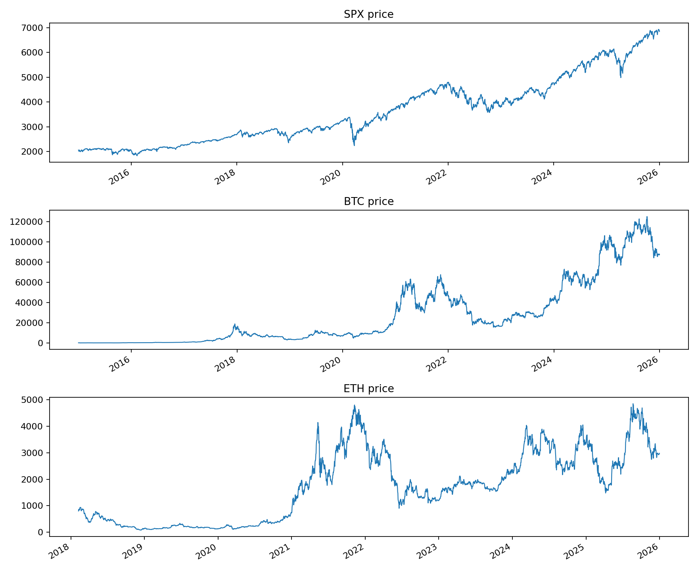
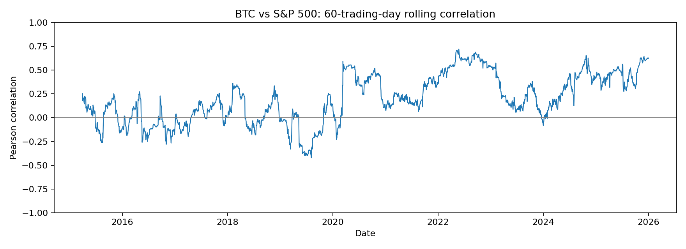
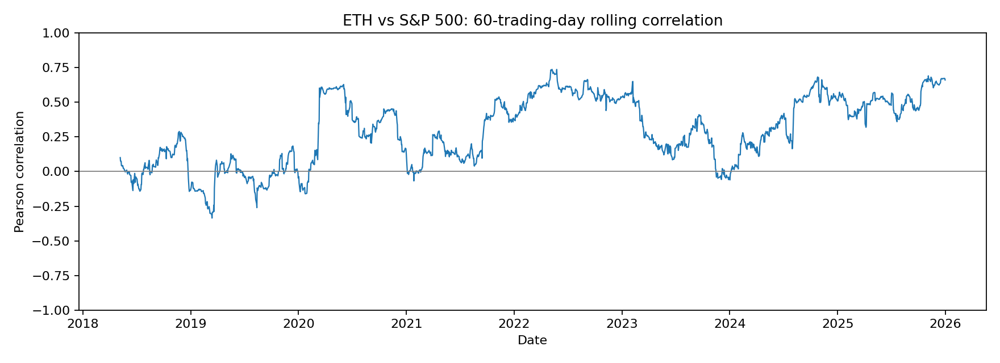

# Are Bitcoin and Ethereum Hedge or Safe Haven Assets?

**Reproducible empirical financial econometrics | 2015–2025**

Python implementation of Mykyta Khymenko’s undergraduate dissertation examining whether Bitcoin and Ethereum hedge US equity risk or act as safe havens during extreme S&P 500 declines. The original study used Bloomberg price exports and EViews; this repository provides a reproducible Python implementation.

## Research question
Do BTC and ETH exhibit zero or negative exposure to S&P 500 returns on average (hedge) and during the bottom 5% of equity-market days (safe haven)?

## Methodology
- Align prices to **S&P 500 trading dates before calculating** daily log returns: `ln(P_t/P_(t-1))`. This reproduces the thesis baseline regressions.
- Baseline OLS: `r_crypto = alpha + beta*r_SPX + error`.
- Stress OLS: `r_crypto = alpha + beta*r_SPX + gamma*(r_SPX*I[r_SPX <= q05]) + error`.
- The **stress-period slope is beta + gamma**, not gamma alone. Interpret confidence intervals and significance before classifying assets.
- 60-observation rolling Pearson correlation on aligned trading-day returns.
- For consistent stress classification, `q05` is computed from the full S&P 500 return sample for both assets. This can differ from the original EViews stress dummy, so stress coefficients are not claimed as exact reproductions.

## Visual overview

### Historical price movements



### Time-varying correlations with the S&P 500

**Bitcoin — 60-trading-day rolling correlation**



**Ethereum — 60-trading-day rolling correlation**



These charts are generated by `src/analysis.py` using the local Bloomberg exports. The original dissertation reports increasing positive correlations particularly after 2020; the figures illustrate how that relationship varies over time.

## Main findings (original dissertation)
| Statistic | BTC | ETH |
|---|---:|---:|
| Baseline SPX beta | 0.849651 | 1.332821 |
| Baseline R² | 0.055305 | 0.101432 |
| Correlation with SPX (asset-specific regression samples) | 0.235169 | 0.318484 |

### Interpretation

- **Hedge test:** Both estimated S&P 500 exposure coefficients are positive and statistically significant, inconsistent with a zero/negative average market exposure.
- **Safe-haven test:** The dissertation reports positive and statistically significant stress interaction coefficients for BTC (0.461916) and ETH (0.478561). These are *interaction effects*, not total stress-period slopes; the total slopes are `beta + gamma`.
- **Time variation:** Rolling correlations change substantially through the sample, illustrating why a single unconditional correlation does not tell the full story.

Both baseline betas are positive and statistically significant. In the original study, positive and significant stress interaction terms also argued against reliable safe-haven behaviour. The BTC/SPX correlation of 0.235169 uses the full BTC sample; in the common three-asset sample it is approximately 0.297140. The code independently recomputes all metrics; inspect `results/regression_results.csv` for actual output.

## Quick start
```bash
python3 -m venv .venv
source .venv/bin/activate
pip install -r requirements.txt
python src/analysis.py
```
On Windows use `.venv\Scripts\activate` instead.

Outputs appear in `results/` and `figures/`. Explore `notebooks/analysis.ipynb` in VS Code or JupyterLab.

## Project layout
```text
data/raw/               Original Bloomberg-exported spreadsheets (local only)
src/analysis.py          Reproducible processing, regressions and plots
notebooks/analysis.ipynb Guided notebook
figures/                 Generated charts
results/                 CSV tables and OLS summaries
```

## Data availability and licensing
**Important:** Original Bloomberg-exported spreadsheets are supplied locally for replication and are **excluded from the public Git repository** due to potential redistribution restrictions. Do not publish the raw data without verifying the applicable Bloomberg licence. To reproduce exactly, place the three original files in `data/raw/` (BTC_Bloomberg.xlsx, ETH_Bloomberg.xlsx, SPX_Bloomberg.xlsx). Generated return-level data are also excluded from public Git by default. The MIT license applies to code only, not third-party market data.

## Notes
- Cryptocurrency trading occurs on weekends, whereas SPX does not. This implementation follows the original thesis's trading-date alignment; alternative daily matching may change results.
- OLS standard errors are classical, matching EViews-style baseline results; heteroskedasticity-robust standard errors are a worthwhile extension.
- Correlation is not causation; positive beta is not evidence of a causal link.
- Research use only; not investment advice.
